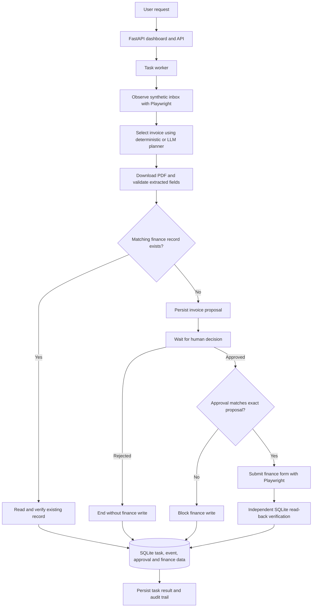

# TaskPilot — Autonomous AI Task Worker

TaskPilot is a local prototype that processes synthetic invoices through a browser-based workflow. It accepts a natural-language request, observes invoice candidates in a simulated inbox, extracts and validates invoice data from a PDF, checks for an existing finance record, and—when a new record is proposed—waits for human approval before submitting the finance form.

TaskPilot is deliberately scoped to invoice processing in a local synthetic environment. It is not a general-purpose computer-use agent or a production accounting system.

## Features

- **Natural-language task intake** through a FastAPI dashboard and API.
- **Two planner modes:** deterministic request interpretation and an LLM planner that returns a constrained, structured invoice-selection decision.
- **LangGraph workflow for the LLM path:** validates the request and planner decision, manages workflow state, and routes supported terminal states.
- **Playwright browser automation** to inspect the synthetic inbox, download invoice PDFs, and interact with the simulated finance application.
- **PDF extraction and schema validation** using `pypdf` and Pydantic.
- **Source/document consistency checks:** extracted vendor, invoice number, and issue date are compared with the selected inbox row.
- **Duplicate handling:** an existing finance record is read and compared with the source invoice; TaskPilot does not submit a second write for a matching record.
- **Human approval before a new finance write:** the proposed invoice is persisted and the task enters `pending_approval`.
- **Approval matching:** before a write, the stored approval must match both the source invoice ID and the extracted invoice fields.
- **Independent read-back verification:** after a new write, TaskPilot reads the finance record from SQLite and compares eight required fields.
- **SQLite persistence:** synthetic inbox records, finance records, task status, approval decisions, and task events.
- **Task history and detail pages** to inspect status, events, invoice data, approval controls, and results.

## Architecture



**Execution-path note:** the LLM planner path is orchestrated with LangGraph. The deterministic planner path is handled by the worker's deterministic workflow. Both paths include invoice extraction, duplicate handling, the approval boundary for new writes, and verification logic; they are not the same internal execution path.

## Technology stack

- Python 3.12+
- FastAPI
- LangGraph
- Playwright
- Pydantic
- `pypdf`
- SQLite
- `httpx` for the OpenAI-compatible LLM request
- `uv` for dependency and environment management
- Pytest
- Gemini-compatible OpenAI API endpoint by default, configurable through environment variables

## Safety and scope

- The companies, invoices, generated PDFs, and finance records are synthetic demo data.
- The default local application URL is `http://127.0.0.1:8000`; it can be overridden with `TASKPILOT_BASE_URL`.
- The worker is designed for the invoice-processing workflow. Arbitrary shell commands, email, payments, and unrestricted external-site actions are outside its supported scope.
- Requests that cannot be matched to a supported invoice should stop for clarification rather than inventing an invoice ID.
- The LLM planner can only propose a constrained selection or request clarification. It does not perform browser actions or finance writes.
- Existing matching finance records follow a read/verification path and do not require approval because no new write is proposed.
- New finance writes require a persisted human approval decision.
- Approval is checked against the exact source invoice ID and extracted invoice fields before the finance form is submitted.
- A rejection is terminal and does not schedule the worker to resume the proposed write.
- Finance records enforce uniqueness for `(vendor, invoice_number)`.
- A new write is reported as successful only after independent read-back verification succeeds.
- SQLite stores task status, approval data, and task events. This is a local prototype audit trail, not a tamper-proof enterprise audit system.

**Do not connect this prototype to real accounting systems or use confidential company information.** It has not been hardened or validated for production use.

## Requirements

- Python 3.12 or later
- [`uv`](https://docs.astral.sh/uv/)
- Playwright Chromium
- An LLM provider API key only if using LLM planner mode

## Run locally

Clone the repository and enter the project directory. Replace the URL with your actual repository URL if needed:

```bash
git clone https://github.com/Santa-Cruz1654/TaskPilot.git
cd TaskPilot
```

Install project dependencies and the browser:

```bash
uv sync --all-groups
uv run playwright install chromium
```

Create a local `.env` file if needed for provider configuration. **Never commit `.env`, API keys, or your local SQLite database.**

### Deterministic planner mode

In Git Bash:

```bash
export TASKPILOT_PLANNER_MODE=deterministic
uv run uvicorn app.main:app --env-file .env
```

In Windows PowerShell:

```powershell
$env:TASKPILOT_PLANNER_MODE = "deterministic"
uv run uvicorn app.main:app --env-file .env
```

Deterministic mode does not require an LLM API key.

### LLM planner mode

Set `TASKPILOT_PLANNER_MODE=llm` and configure a valid provider key. The planner supports these environment variables:

| Variable | Purpose |
|---|---|
| `TASKPILOT_PLANNER_MODE` | `deterministic` or `llm` |
| `TASKPILOT_LLM_API_KEY` | Preferred provider API key variable |
| `GROQ_API_KEY` | Legacy-compatible API key variable |
| `TASKPILOT_LLM_MODEL` | Optional model override |
| `TASKPILOT_LLM_BASE_URL` | Optional OpenAI-compatible API base URL |
| `TASKPILOT_BASE_URL` | Base URL for the local TaskPilot application |
| `TASKPILOT_DATA_DIR` | Optional data directory override |
| `TASKPILOT_DB_PATH` | Optional SQLite database path override |
| `TASKPILOT_CHROMIUM_EXECUTABLE` | Optional Chromium executable override |

The planner's configured default model and base URL are defined in `app/planner.py`. Provider availability, credentials, and quotas can affect LLM-mode execution.

## Local pages

With the server running, open:

- Dashboard / Worker: <http://127.0.0.1:8000/>
- Synthetic inbox: <http://127.0.0.1:8000/inbox>
- Simulated finance application: <http://127.0.0.1:8000/finance>
- New finance record form: <http://127.0.0.1:8000/finance/new>
- Task history: <http://127.0.0.1:8000/history>
- API documentation: <http://127.0.0.1:8000/docs>

## Example workflow

Example request:

```text
Record invoice ALP-2026-023 from Alpine Manufacturing
```

The exact invoice and its current finance-record state determine the path:

1. TaskPilot observes the inbox and selects a candidate using the configured planner mode.
2. It downloads the PDF and validates the extracted fields against the selected inbox row.
3. If a matching finance record already exists, TaskPilot checks that record and does not submit a second write.
4. If no matching finance record exists, TaskPilot persists the proposal and pauses at `pending_approval`.
5. A person reviews the proposal on the task detail page and chooses **Approve and submit invoice** or **Reject — do not write**.
6. On approval, TaskPilot resumes the task, re-observes and re-extracts the invoice, and checks that the persisted approval matches the exact source invoice and fields before submitting the finance form.
7. After a new write, TaskPilot reads the finance record back and checks the saved fields. It reports completion only if verification passes.

If the invoice data no longer matches the stored approval, the write is blocked. A rejected proposal is not submitted.

## Approval API

Endpoint:

```http
POST /api/tasks/{task_id}/approval
```

Approve a pending proposal:

```json
{"decision": "approve"}
```

Reject a pending proposal:

```json
{"decision": "reject"}
```

The request body accepts only `approve` or `reject`. The endpoint only resolves tasks in `pending_approval`. A successful decision returns HTTP `202`; a task that is missing returns `404`; an invalid body returns `422`; and a second or otherwise non-pending resolution returns `409`.

Approval is persisted with the source invoice ID and exact invoice fields. On approval, the task is queued for worker execution. On rejection, the task becomes `rejected` and the worker is not resumed for the proposed write.

See the running API documentation at <http://127.0.0.1:8000/docs> for request and response schemas.

## Independent verification

After a new finance write, TaskPilot reads the finance record back from SQLite and compares eight fields:

1. Record exists
2. Vendor matches
3. Invoice number matches
4. Issue date matches
5. Due date matches
6. Amount matches
7. Currency matches
8. Source document ID matches

A matching existing record is also checked against the source invoice before TaskPilot reports that it was already recorded. A browser success message alone is not treated as proof that the data was saved correctly.

## API overview

- `POST /api/tasks` — create a task; request body includes `{"request": "..."}`. Returns HTTP `202`.
- `GET /api/tasks` — list recent tasks.
- `GET /api/tasks/{task_id}` — retrieve task status, event history, approval data, and result.
- `POST /api/tasks/{task_id}/approval` — approve or reject a pending finance write.
- `GET /api/finance/invoices/verify?vendor=...&invoice_number=...` — read-only finance-record lookup.
- `GET /invoices/{invoice_id}/download` — download a synthetic invoice PDF from the local application.

Task states used by the application include `queued`, `running`, `pending_approval`, `needs_input`, `completed`, `failed`, and `rejected`.

## Run tests

Run the test suite in deterministic mode from Git Bash:

```bash
export TASKPILOT_PLANNER_MODE=deterministic
uv run pytest
```

The development run previously reported **49 passed** with deterministic planner mode enabled. Re-run the tests against your current checkout to confirm its current state. The tests include planner schema/configuration behavior, invoice extraction and validation, task and database behavior, API behavior, approval decisions, exact proposal matching, graph behavior, and worker behavior. Planner tests mock the provider rather than requiring live API calls.

## Project status and limitations

TaskPilot contains code and automated tests for the synthetic invoice-processing workflow, including approval handling, duplicate detection, and read-back verification. The test suite's passing result supports the behaviors covered by those tests; it does not by itself prove every end-to-end path or all failure conditions.

The current scope does **not** include:

- General-purpose autonomous computer use
- Production deployment or production-grade security controls
- Integration with real accounting or enterprise systems
- Production-scale reliability, load, or security validation

Treat this as a local engineering prototype. Describe individual behaviors as demonstrated only when you have verified them in a local run or can point to a test that covers the specific behavior.
