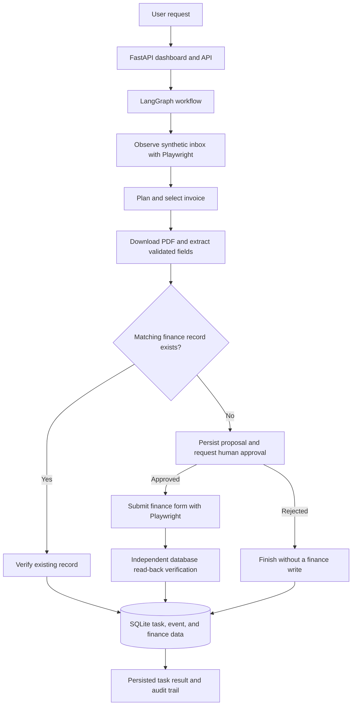

# TaskPilot — Autonomous AI Task Worker

TaskPilot is a local, synthetic-data prototype of an autonomous business task worker. It accepts a natural-language instruction, orchestrates a browser-based invoice workflow, and independently verifies the result.

The project's completed scope is **invoice processing with duplicate prevention and human approval before new finance writes**. It is not intended to be a general-purpose computer-use agent.

## Features

- **Natural-language task intake** through the FastAPI dashboard and API.
- **LangGraph orchestration** for task validation, inbox observation, invoice selection, extraction, approval, writing, and verification.
- **Two planner modes:** a deterministic mode for predictable local runs and an LLM mode using a Gemini model through an OpenAI-compatible endpoint.
- **Playwright browser automation** to inspect the synthetic inbox, download invoice documents, and interact with the simulated finance application.
- **PDF extraction and validation** using `pypdf` and Pydantic.
- **Human approval before new writes:** TaskPilot persists the proposed invoice and pauses in `pending_approval` until a person approves or rejects it.
- **Exact approval matching:** the stored approval is checked against the source invoice and extracted invoice fields before a finance write proceeds.
- **Duplicate prevention:** existing matching records follow a verification path and do not need approval or another write.
- **Independent read-back verification:** after a new write, TaskPilot reads the finance record back and checks eight fields.
- **SQLite persistence and audit trail** for task statuses, approval decisions, workflow events, and finance records.
- **Task history and detail views** for reviewing the result, timeline, invoice fields, and verification evidence.

## Architecture



## Technology stack

- Python 3.12+
- FastAPI
- LangGraph
- Playwright
- Pydantic
- `pypdf`
- SQLite
- `uv`
- Pytest
- Gemini API through an OpenAI-compatible endpoint

## Safety and scope

- Companies, invoices, PDFs, and finance records are synthetic demo data generated for local use.
- The browser workflow targets the local TaskPilot application at `http://127.0.0.1:8000`.
- TaskPilot is built for the defined invoice-processing workflow; arbitrary URL navigation, shell commands, email, payments, and unrestricted external-site actions are outside the supported scope.
- Ambiguous or unsupported requests should stop for clarification rather than guess.
- Existing matching invoices are verified without a second write and without requesting approval.
- New finance writes require an explicit human approval decision.
- Rejection ends the proposed write path without submitting the invoice.
- Approval is persisted and matched against the exact source invoice and extracted fields. A mismatch blocks the write.
- Completion after a new write requires an independent read-back comparison; a browser success message alone is insufficient.
- Task status and workflow events are stored in SQLite for auditability.

This is a prototype, not a production-ready accounting system. Do not connect it to real financial systems or use confidential company information.

## Requirements

- Python 3.12 or later
- [`uv`](https://docs.astral.sh/uv/)
- Playwright Chromium

## Run locally

Clone the repository and enter its directory. Replace the URL below with your GitHub repository URL:

```bash
git clone <YOUR_GITHUB_REPOSITORY_URL>
cd taskpilot
```

Install the dependencies and Chromium browser:

```bash
uv sync --all-groups
uv run playwright install chromium
```

Create a local `.env` file for any required provider configuration. **Do not commit `.env` or API keys.**

Start TaskPilot in deterministic mode:

```bash
export TASKPILOT_PLANNER_MODE=deterministic
uv run uvicorn app.main:app --env-file .env
```

On Windows PowerShell, set the mode with:

```powershell
$env:TASKPILOT_PLANNER_MODE = "deterministic"
uv run uvicorn app.main:app --env-file .env
```

To use the LLM planner instead, set `TASKPILOT_PLANNER_MODE=llm` in your environment and configure a valid provider API key in `.env`. The application supports these configuration variables:

- `TASKPILOT_PLANNER_MODE` — `deterministic` or `llm`.
- `TASKPILOT_LLM_API_KEY` — provider API key; preferred configuration variable.
- `TASKPILOT_LLM_MODEL` — model name, if overriding the configured default.
- `TASKPILOT_LLM_BASE_URL` — OpenAI-compatible API base URL, if overriding the configured default.

The LLM planner depends on provider availability and account quota. Deterministic mode is available for predictable local runs without an LLM request.

## Local pages

With the server running, open:

- Dashboard / Worker: [http://127.0.0.1:8000/](http://127.0.0.1:8000/)
- Task history: [http://127.0.0.1:8000/history](http://127.0.0.1:8000/history)
- Synthetic inbox: [http://127.0.0.1:8000/inbox](http://127.0.0.1:8000/inbox)
- Simulated finance application: [http://127.0.0.1:8000/finance](http://127.0.0.1:8000/finance)
- API documentation: [http://127.0.0.1:8000/docs](http://127.0.0.1:8000/docs)

## Example workflow

Example request:

```text
Record invoice ALP-2026-023 from Alpine Manufacturing
```

For an invoice without an existing finance record, TaskPilot extracts the fields and pauses at `pending_approval`. Open the task from the history page, review the proposed invoice data, and choose **Approve and submit invoice** or **Reject — do not write**.

- **Approved:** TaskPilot resumes, validates that the stored approval matches the exact invoice proposal, writes the finance record, and independently verifies the saved record.
- **Rejected:** the task ends as `rejected` and the proposed finance write is not submitted.
- **Duplicate:** if a matching record already exists, TaskPilot verifies that record and does not create a duplicate or request a write approval.

## Approval API

Resolve a pending approval using:

`POST /api/tasks/{task_id}/approval`

Approve:

```json
{"decision":"approve"}
```

Reject:

```json
{"decision":"reject"}
```

The endpoint accepts a decision only while the task is `pending_approval`. A second decision receives HTTP `409`. The persisted approval is matched against the exact source invoice ID and extracted fields before the write proceeds.

See the running API documentation at [http://127.0.0.1:8000/docs](http://127.0.0.1:8000/docs) for the current request and response schemas.

## Independent verification

After a new finance write, TaskPilot reads the record back independently and checks these eight fields:

1. Record existence
2. Vendor
3. Invoice number
4. Issue date
5. Due date
6. Amount
7. Currency
8. Source document ID

A successful browser submission by itself is not considered proof of completion.

## API overview

- `POST /api/tasks` — create a task and start background execution. The request body includes a natural-language `request`.
- `GET /api/tasks` — list recent tasks.
- `GET /api/tasks/{task_id}` — retrieve task status, event history, and result.
- `POST /api/tasks/{task_id}/approval` — approve or reject a pending finance write.
- `GET /api/finance/invoices/verify?vendor=...&invoice_number=...` — read-only invoice verification.

Task states include `queued`, `running`, `needs_input`, `pending_approval`, `completed`, `failed`, and `rejected`.

## Run tests

For a deterministic test run in Git Bash:

```bash
export TASKPILOT_PLANNER_MODE=deterministic
uv run pytest
```

The completed test suite reported **49 passed** in the deterministic configuration. LLM-mode behavior also depends on having a valid provider configuration and an available provider.

## Project status and limitations

The prototype has demonstrated:

- New invoice creation after human approval.
- Rejection without a finance write.
- Duplicate detection and verification without a second write.
- Independent read-back verification of eight invoice fields.
- Persisted task events and approval decisions.

TaskPilot is feature-complete for this scoped synthetic invoice-worker prototype. General-purpose autonomous tasks, production deployment, and integration with real accounting systems are outside the current scope.
